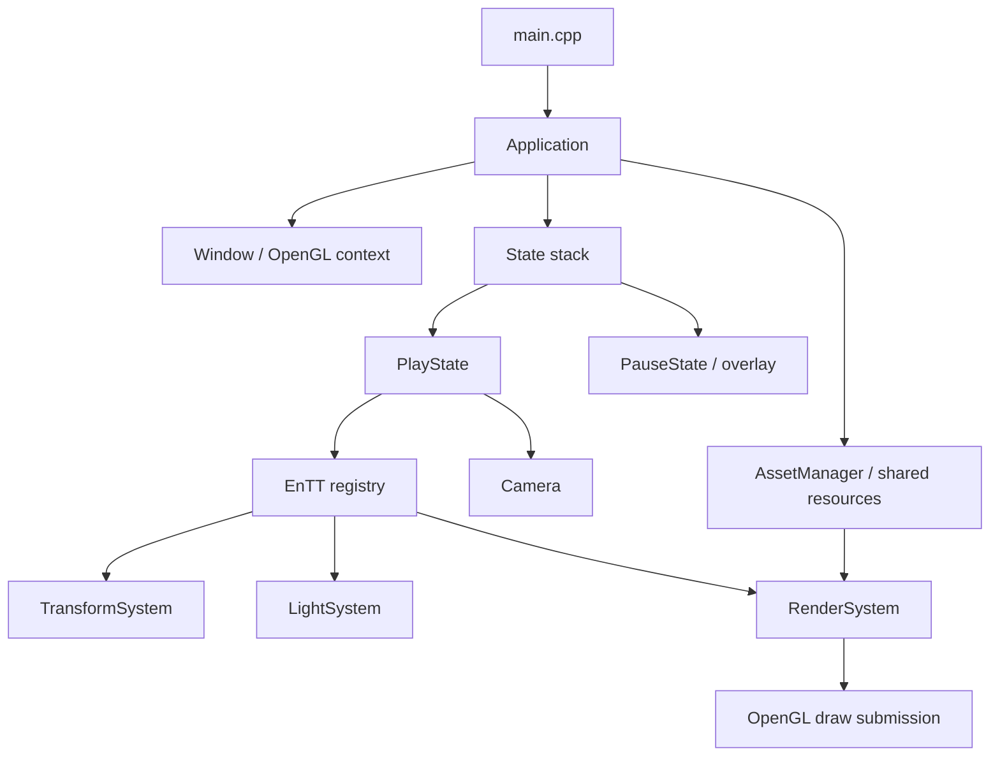

# OpenGL Game Engine

A custom 3D rendering and game engine project built with **C++20**, **OpenGL**, and **EnTT**. Currently uses features up to OpenGL 3.3.
The project is under active development.

## Showcase 

<div align="left">
  <a href="https://youtu.be/B5eTTHENevE">
    
  </a>
</div>

## Implemented Features

- **Application states:** a play/pause state stack. Pausing stops updates and draws a transparent overlay over the scene.
- **Camera and input:** a free-flying camera with keyboard movement, mouse look, scroll-controlled field of view, and support for window resizing.
- **GPU data:** uniform buffers for camera, light, and material data, plus cached shader uniform locations.
- **Meshes:** indexed meshes with position, normal, and UV data. Cubes, spheres, and planes can be generated procedurally.
- **Textures and materials:** image loading through stb_image, solid-color textures, and materials with diffuse/specular maps, shininess, and specular intensity.
- **Models:** a model groups meshes with their materials, so one object can contain several meshes with different materials. Assimp imports static models and their diffuse/specular textures.
- **Dynamic model loading:** press L while playing to enter a cache key, model path, and UV-flip flag in the console, then spawn the model in front of the camera.
- **Shared assets:** shaders, textures, materials, meshes, and models are cached in the AssetManager and accessed through handles. Entities and states can reuse the same assets.
- **ECS:** EnTT manages entities with components and systems for transforms, lights, and rendering.
- **Lighting:** Blinn-Phong lighting with one directional light, up to 16 point lights, and 8 spotlights. Point lights and spotlights are selected by distance to the camera.
- **Render submission:** a reusable draw queue sorted by shader and material to reduce repeated bindings. Meshes are drawn with indexed draw calls and depth testing.

## Libraries Used

The engine is written in C++20 and uses OpenGL for rendering, along with:

- [GLFW](https://www.glfw.org/) for the window, OpenGL context, and keyboard/mouse input.
- [GLAD](https://github.com/Dav1dde/glad) to load OpenGL functions.
- [GLM](https://github.com/g-truc/glm) for vectors, matrices, and quaternions.
- [EnTT](https://github.com/skypjack/entt) for the Entity Component System (ECS) implementation.
- [Assimp](https://www.assimp.org/) to import models and their material data.
- [stb_image](https://github.com/nothings/stb/blob/master/stb_image.h) to load image files for textures.

## Download Build

Download the Windows build from [release v1.0.0](https://github.com/datwave999/Graphics-Programming-WEC-Systems/releases/tag/v1.0.0), extract it, and run the executable from the extracted folder. Keep the supplied DLLs and assets in place so the engine can find them.

It opens a 1920 × 1080 window with a test scene containing procedural shapes, imported models, moving objects, and multiple lights. The mouse is captured for camera control, and the window title shows the FPS. VSync is disabled.

## Build from Source

On Windows, install Visual Studio with the Desktop development with C++ workload, the MSVC v145 toolset, and a Windows 10 SDK. The current build requests an OpenGL 4.6 core context, so your GPU and driver need to support it.

1. Clone or download the repository, keeping the dependency headers and libraries under `Linking/`.
2. Open `OpenGL-GameEngine.slnx` in Visual Studio and select **x64**, then **Debug** or **Release**.
3. Set **Project Properties → Debugging → Working Directory** to `$(ProjectDir)` so the engine can find `assets/`.
4. Build the solution and copy `glfw3.dll` and `assimp-vc145-mt.dll` from the project folder beside the generated executable if needed.
5. Run with **F5** or **Ctrl+F5**.

## Controls

| Input | Action |
| --- | --- |
| W / S | Move forward / backward |
| A / D | Move left / right |
| Space / Left Ctrl | Move up / down |
| Left Shift | Hold for a speed boost |
| Mouse | Look around |
| Scroll wheel | Adjust field of view |
| L | Load/spawn a model through the console while playing |
| Esc | Pause / resume and release / recapture the cursor |

While paused, the scene remains visible beneath the overlay, but gameplay, camera, and light updates stop. Close the window to exit.

## Dynamic Model Loading

Press **L** in-game, switch to the console window, and enter the following:

```text
Cache key: backpack
Model path: assets/Models/backpack/backpack.obj
Flip UVs (0 or 1): 1
```

The model will spawn **in front of the camera** using the core lighting shader.

**How To Use:**

- **Folder Structure:** Keep each model (file, materials, and textures) flat inside its own folder under `assets/Models/`. No subfolders.
- **Paths:** Enter the exact file path (relative to the working directory or absolute).
- **Caching:** Entering an existing cache key instantly reuses the loaded model (ignoring new path/UV inputs).
- **Execution:** Input and loading are synchronous (the game pauses). Invalid inputs or failed imports simply abort the spawn.

## Architecture Tree

`Application` owns the window, shared `AssetManager`, and state stack. `PlayState` owns the camera, EnTT registry, and ECS systems; entities reference shared resources through asset handles.



Each active play frame updates the camera, updates gameplay transforms, rebuilds dirty matrices, gathers lights, and uploads the camera matrices before rendering. The renderer extracts commands from ECS data, sorts them by shader/material, and submits indexed draws. Only the top state updates; rendering starts at the highest opaque state and includes overlays above it.

GPU resources are released before the window destroys the OpenGL context. See the architecture guide for the complete frame order and ownership rules.

## Documentation

Read the guides in this order for a walkthrough of the engine.

| Guide | Covers |
| --- | --- |
| [1. Architecture](OpenGL-GameEngine/docs/1.Architecture.md) | Application lifecycle, window/input, camera, state stack, dynamic model loading, frame order, and resource ownership. |
| [2. Graphics Pipeline](OpenGL-GameEngine/docs/2.GraphicsPipeline.md) | Render commands, vertex data, UBO layouts, shaders, lighting, and graphics wrappers. |
| [3. Resources](OpenGL-GameEngine/docs/3.Resources.md) | Asset handles, caching, procedural geometry, Assimp importing, and asset usage examples. |
| [4. ECS Guide](OpenGL-GameEngine/docs/4.ECS_Guide.md) | Entities, components, systems, views, scene setup, and adding new behavior. |
| [5. Optimizations](OpenGL-GameEngine/docs/5.Optimizations.md) | Candidate improvements, their tradeoffs, and profiling workloads to evaluate them. |

## Project Layout

```text
OpenGL-GameEngine.slnx
Linking/                          Dependency headers and libraries
OpenGL-GameEngine/
├── assets/                       Shaders, textures, and models
├── docs/                         Detailed engine documentation
├── include/                      Core, Graphics, ECS, and Resources headers
├── lib/                          GLAD and stb implementation sources
└── src/                          Engine implementation and main.cpp
```

## Current Limitations and Future Work

- **Current optimizations:** shared asset handles, dirty transform flags, a reused render queue sorted by shader/material, cached uniform locations, and distance-based light selection. Transforms are still visited each update, the draw queue is rebuilt each render, and each command produces a separate draw call.
- **Future optimizations:** smaller render commands, tracking changed transforms, frustum culling, instancing, and less repeated light processing and GPU data transfer. SSBOs, shader consolidation, and Forward+ rendering are also being considered, with profiling to guide which changes to make first.
- **Future features:** PBR materials and lighting, HDR rendering with bloom, dynamic shadows, a skybox, and an alternative deferred rendering pipeline.

See the [Optimizations guide](OpenGL-GameEngine/docs/5.Optimizations.md) for the full list.

## Learning Resources

These are the tutorials and references I've used while building the engine:

- [LearnOpenGL](https://learnopengl.com/).
- [C++ OpenGL Tutorial](https://www.youtube.com/playlist?list=PLysLvOneEETPlOI_PI4mJnocqIpr2cSHS) on YouTube.
- Selected videos from [The Cherno's Game Engine series](https://www.youtube.com/playlist?list=PLlrATfBNZ98dC-V-N3m0Go4deliWHPFwT).
- [EnTT documentation](https://github.com/skypjack/entt/wiki) on GitHub.

### Use of AI

I use AI to learn unfamiliar concepts, figure out how to manage a growing codebase, and work through the implementation of new features. I don't have AI agents writing the engine for me. I mostly write the code myself. When I do use an AI-generated snippet, it's a short section that I read and understand line by line before using it.

## License

The project is intended to be open-source. The specific license is **TBD (To Be Decided)**.