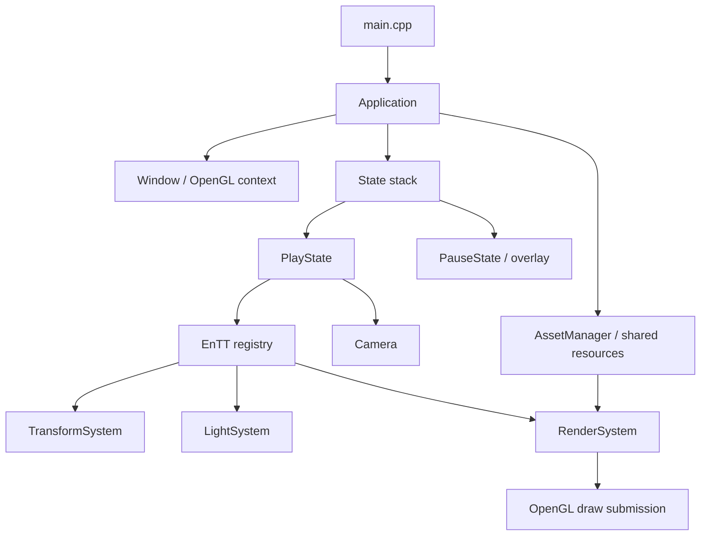

# OpenGL-GameEngine

A custom 3D rendering and game engine project built with **C++20**, **OpenGL 4.6**, and **EnTT**.

The project is under active development, exploring an Entity Component System (ECS) architecture and Data-Oriented Design (DOD). The current sandbox combines procedural geometry, imported models, animated transforms, and multiple light types in a scene you can explore with a free-flying camera.

## Implemented Features

- **Forward rendering:** indexed mesh drawing, depth testing, Blinn-Phong lighting, and unlit shaders.
- **Lighting:** one directional light, up to 16 point lights and 8 spotlights, with the closest point/spot lights selected relative to the camera.
- **ECS:** EnTT-backed entities and components, with separate transform, light, and render systems.
- **Shared assets:** handle-based access to cached shaders, textures, materials, meshes, and models.
- **Geometry and importing:** procedural cubes, spheres, and planes, plus static model loading through Assimp.
- **GPU data:** uniform buffers for camera, light, and material data; cached shader uniform locations.
- **Render submission:** a reusable command queue sorted by shader and material to reduce repeated bindings.
- **Application states:** play/pause state stack with a transparent pause overlay.
- **Camera and input:** keyboard movement, mouse look, scroll-controlled field of view, and framebuffer resizing.

## Getting Started

### Requirements

- Windows and Visual Studio with the Desktop development with C++ workload.
- MSVC **v145** toolset and a Windows 10 SDK, as configured in the project.
- A GPU and driver supporting an **OpenGL 4.6 core** context.
- The dependency headers and libraries under `Linking/`.

The project uses GLFW for window/input handling, GLAD for OpenGL function loading, GLM for math, EnTT for ECS, Assimp for model importing, and stb_image for image loading. GLAD and stb implementation sources are included in the project.

### Build and Run

1. Open `Graphics-Programming-WEC-Systems.slnx` in Visual Studio.
2. Select **x64** and either **Debug** or **Release**. The external include/library paths and linker dependencies are configured for x64.
3. Build the solution.
4. In the project properties for the selected configuration, set **Debugging → Working Directory** to `$(ProjectDir)`. The application loads shaders, textures, and models using paths relative to the project folder.
5. Ensure `glfw3.dll` and `assimp-vc145-mt.dll` are beside the generated executable. Copies are provided in the project folder; copy them to the build output directory if needed.
6. Run the project with **F5** or **Ctrl+F5**.

The sandbox opens a 1920 × 1080 window and captures the mouse for camera control. VSync is currently disabled, and the window title displays an FPS counter.

If Visual Studio reports a missing toolset or SDK, install the versions configured above. If shaders or models cannot be found, check the working directory and the `assets/` folder.

## Controls

| Input | Action |
| --- | --- |
| W / S | Move forward / backward |
| A / D | Move left / right |
| Space / Left Ctrl | Move up / down |
| Left Shift | Hold for a speed boost |
| Mouse | Look around |
| Scroll wheel | Adjust field of view |
| Esc | Pause / resume and release / recapture the cursor |

While paused, the scene remains visible beneath the overlay, but gameplay, camera, and light updates stop. Close the window to exit.

## Architecture at a Glance

`Application` owns the window, shared `AssetManager`, and state stack. `PlayState` owns the camera, EnTT registry, and ECS systems; entities reference shared resources through asset handles.



Each active play frame updates gameplay transforms, rebuilds dirty matrices, updates the camera, and gathers lights before rendering. The renderer extracts commands from ECS data, sorts them by shader/material, and submits indexed draws. Only the top state updates; rendering starts at the highest opaque state and includes overlays above it.

GPU resources are released before the window destroys the OpenGL context. See the architecture guide for the complete frame order and ownership rules.

## Documentation

Read the guides in this order for a walkthrough of the engine, or jump directly to the area you want to change.

| Guide | Covers |
| --- | --- |
| [1. Architecture](Graphics-Programming-WEC-Systems/docs/1.Architecture.md) | Application lifecycle, window/input, camera, state stack, frame order, and resource ownership. |
| [2. Graphics Pipeline](Graphics-Programming-WEC-Systems/docs/2.GraphicsPipeline.md) | Render commands, vertex data, UBO layouts, shaders, lighting, and graphics wrappers. |
| [3. Resources](Graphics-Programming-WEC-Systems/docs/3.Resources.md) | Asset handles, caching, procedural geometry, Assimp importing, and asset usage examples. |
| [4. ECS Guide](Graphics-Programming-WEC-Systems/docs/4.ECS_Guide.md) | Entities, components, systems, views, scene setup, and adding new behavior. |
| [5. Future Optimizations](Graphics-Programming-WEC-Systems/docs/5.FutureOptimizations.md) | Candidate improvements, their tradeoffs, and profiling workloads to evaluate them. |

For practical extension examples, start with **Resources** to create/load assets and **ECS Guide** to attach them to entities or add a new system.

## Project Layout

```text
Graphics-Programming-WEC-Systems.slnx
Linking/                          Dependency headers and libraries
Graphics-Programming-WEC-Systems/
├── assets/                       Shaders, textures, and models
├── docs/                         Detailed engine documentation
├── include/                      Core, Graphics, ECS, and Resources headers
├── lib/                          GLAD and stb implementation sources
└── src/                          Engine implementation and main.cpp
```

## Current Limitations and Future Work

The renderer currently submits one draw per model node, without frustum culling or instancing. Imported meshes are static: skeletal animation, imported scene hierarchy, and node transforms are not supported. The material path uses diffuse/specular maps; embedded textures and additional material maps are not handled.

The documentation also records asset-cache and error-handling limitations, including possible cache collisions between models in the same directory. Refer to [Resources](Graphics-Programming-WEC-Systems/docs/3.Resources.md#current-import--asset-limits) before extending the import path.

Candidate improvements include smaller render commands, tracking changed transforms, frustum culling, instancing, and reducing repeated light work. These are **proposals, not implemented features**; the [Future Optimizations guide](Graphics-Programming-WEC-Systems/docs/5.FutureOptimizations.md) explains when to measure and consider each change.

## License

The project is intended to be open-source. The specific license is **TBD (To Be Decided)**.